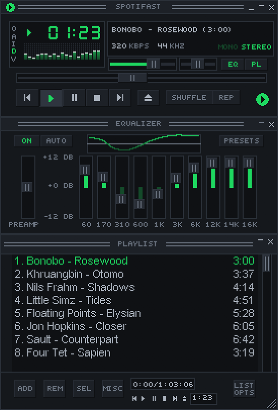
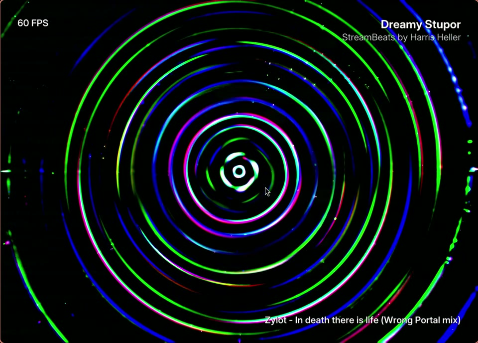

<p align="center">
  
</p>

<h1 align="center">Resonix</h1>

<p align="center"><strong>YouTube Music, native and fast.</strong><br>A lightweight desktop music player in Rust for Linux, macOS, and Windows — no browser engine, no Electron.</p>

<p align="center">
  <a href="https://github.com/ItsARCn/Resonix/releases"><strong>Releases</strong></a> ·
  <a href="docs/_guide/getting-started.md">Getting started</a> ·
  <a href="docs/_guide/using-spotifast.md">User guide</a> ·
  <a href="CONTRIBUTING.md">Contribute</a>
</p>

<p align="center">
  <a href="Cargo.toml"></a>
  <a href="#build-from-source"></a>
  <a href="LICENSE"></a>
</p>

Resonix combines a pure native desktop interface built with [egui](https://www.egui.rs) and [fastframe](https://fastframe.dev) with a YouTube / YouTube Music Rust audio backend. Search, stream, download offline tracks, customize themes and classic skins, and watch MilkDrop visuals — without a browser engine or a Spotify account.

[Features](#your-music-on-your-desktop) · [What Resonix adds](#what-resonix-adds) · [Build from source](#build-from-source) · [Mini player](#the-winamp-mini-player) · [MilkDrop](#music-in-motion) · [Credits](#credits-and-acknowledgements)

---

## Your music, on your desktop

| Feature | What you can do |
|---|---|
| **YouTube & YouTube Music playback** | Search songs, albums, artists, and playlists across YouTube Music and YouTube, stream locally via `yt-dlp` and `ffmpeg` / `symphonia` / `rodio`, and play without external browser tabs. |
| **Offline downloads & library** | Save tracks and collections locally in SQLite, organize Liked Songs and playlists, edit playlist details, and pin favourites in the sidebar. |
| **Local files** | Play local audio files from a folder chosen in Settings alongside streamed tracks. |
| **Queue & Radio** | Queue tracks, use **Play next**, reorder or remove items, and start instant song/artist radio mixes. |
| **Lyrics** | Synced and plain lyrics via [LRCLIB](https://lrclib.net) with caching and fullscreen view. |
| **Discord Rich Presence** | Advertise the current track, artist, artwork, live progress timestamps, **Listen on YouTube**, and **Get Resonix** buttons over local Discord / Vesktop IPC (toggleable in Settings). |
| **10-band Equalizer & Visualisers** | Real-time 10-band EQ, balance/mono controls, player-bar and titlebar spectrum/oscilloscope visualisers, and full [MilkDrop](docs/_guide/milkdrop.md) rendering. |
| **Themes & Omarchy** | Light, dark, follow-system, custom JSON colour palettes, album-art accent tinting, and automatic [Omarchy](contrib/omarchy/resonix-theme) theme reloading. |
| **Winamp & WMP mini player** | Switch between classic `.wsz` / `.wmz` skins and Resonix's built-in **Resonix Tall** and **Resonix Wide** skins. |
| **Desktop integration** | System tray playback, MPRIS / OS Now Playing media controls, global CLI remote control (`resonix play-pause`, `resonix next`, `resonix now-playing`, etc.), and 16+ UI translations. |

---

## What Resonix adds

Resonix merges **Sunder**'s YouTube audio/library backend cleanly into **Spotifast**'s native `egui` desktop shell, and adds:

* **Direct YouTube & YouTube Music backend integration** — replaced Spotify OAuth/Connect/Soloist flows with local SQLite + `yt-dlp` / `ffmpeg` streaming and downloads inside the native UI.
* **Discord Rich Presence (`src/discord.rs`)** — native Unix socket / Windows named-pipe IPC client with Resonix's Discord application ID, album artwork, live timestamps, `Listen on YouTube` / `Get Resonix` buttons, and a Playback setting toggle.
* **Resonix branding & desktop polish** — red + white Resonix app/tray/packaging icons, renamed crate/binary/data paths (`resonix`), **Custom title bar** enabled by default, Home section widget-ID isolation fixes, and Fedora `libprojectM` CMake `lib` build support (`.cargo/config.toml` + `packaging/rpm/libdir.cmake`).

---

## Build from source

### Runtime requirements

* [`yt-dlp`](https://github.com/yt-dlp/yt-dlp) and [`ffmpeg`](https://ffmpeg.org) available on `PATH` for YouTube search/stream extraction and downloads.

### Build & run

```sh
cargo run
```

To build without the MilkDrop C++ (`libprojectM`) visualizer:

```sh
cargo run --no-default-features
```

To inspect the interface using built-in sample data:

```sh
cargo run --features demo -- --demo
```

> **Note for Fedora:** `.cargo/config.toml` automatically sets `CMAKE_TOOLCHAIN_FILE=packaging/rpm/libdir.cmake` so `projectm-sys` installs static libraries into `lib` rather than `lib64`. Requires `cmake`, a C++ compiler, `clang`/`libclang`, and system audio/GL dev headers (`alsa-lib-devel`, `openssl-devel`, etc.).

---

## The Winamp mini player

A classic look for your music supporting Winamp 2 `.wsz` and Windows Media Player `.wmz` skins alongside Resonix's built-in **Resonix Tall** and **Resonix Wide** skins, an equalizer, playlist window, and MilkDrop panel. Switch with **Ctrl+M** (**Cmd+Shift+M** on macOS), the shrink button, or Settings.

<p align="center">
  
</p>

See [the Winamp mini player guide](docs/_guide/winamp.md) for skin details and window sizes.

---

## Music in motion

MilkDrop reacts to music playing on this computer through `libprojectM` in its own window or fullscreen. Open it from the visualiser button, Settings, or the mini player's **V** menu.



Read [the MilkDrop guide](docs/_guide/milkdrop.md) for controls, preset locations, and troubleshooting.

---

## Documentation

* [Getting started](docs/_guide/getting-started.md) — install, runtime dependencies (`yt-dlp`, `ffmpeg`), and playback basics
* [Everyday use](docs/_guide/using-spotifast.md) — keyboard shortcuts, CLI commands, and updates
* [Settings and files](docs/_reference/settings-and-files.md) — configuration keys, storage folders, and logs
* [How it connects](docs/_reference/how-it-connects.md) — YouTube extraction, LRCLIB lyrics, Discord IPC, and update endpoints
* [Privacy](docs/_reference/privacy.md) · [Troubleshooting](docs/_guide/troubleshooting.md) · [Translating](docs/_reference/translating.md)

---

## Credits and acknowledgements

Resonix is built on top of two open-source Rust music projects, and would not exist without the work of both upstream authors and communities:

* **[Spotifast](https://github.com/crmne/spotifast)** by **[Carmine Paolino](https://paolino.me)** (MIT License) — the original `egui` + `fastframe` native desktop interface, custom titlebar, Winamp/WMP skin parser & scripting runtime, MilkDrop `libprojectM` host, 10-band equalizer, theme/Omarchy integration, lyrics UI, localization pipeline, and cross-platform tray/MPRIS/Now Playing architecture.
* **[Sunder](https://github.com/FrogSnot/Sunder)** (AGPL-3.0 License) — the YouTube & YouTube Music search/explore engine, `yt-dlp` stream extraction & download pipeline, local audio decoding/playback, SQLite persistence layer, and inspiration for the Discord Rich Presence integration.

Resonix also uses [egui](https://www.egui.rs), [fastframe](https://fastframe.dev), [symphonia](https://github.com/pdeljanov/Symphonia), [rodio](https://github.com/RustAudio/rodio), [libprojectM](https://github.com/projectM-visualizer/projectm), [LRCLIB](https://lrclib.net), the [Inter](https://rsms.me/inter/) typeface (OFL), and [Lucide](https://lucide.dev) icons (ISC).

Resonix is an independent project and is not affiliated with YouTube, Google, or Spotify AB.

---

## Contributing

Read [CONTRIBUTING.md](CONTRIBUTING.md) before opening an issue or pull request. See [PACKAGING.md](PACKAGING.md) for package build notes.
